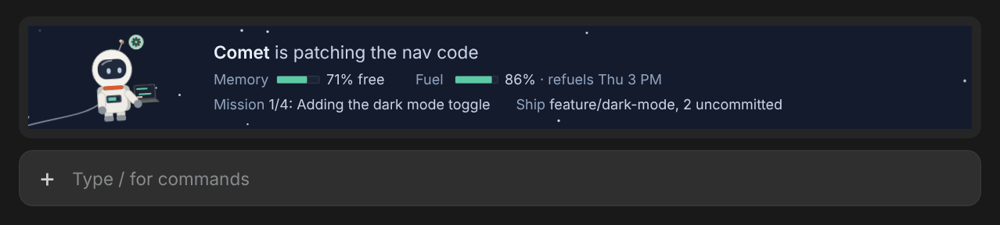

# Comet, an astronaut buddy for Claude Code

A little astronaut who floats in a strip of space above your prompt box in the Claude desktop app. Comet acts out whatever Claude is doing, says it in a line of text, and keeps an eye on your context window, weekly usage, task list and git branch.



## Install

Comet is built for the **Code tab of the Claude desktop app**, and that's where it's been tested.

1. In the desktop app, click **+** next to the prompt box, then **Plugins**.
2. Choose **Add marketplace** and enter `Shoot2Skoot/comet-in-claude`.
3. Choose **Add plugin** and pick **astronaut-buddy**.
4. Start a new session in the Code tab. Comet flies in when it starts.

To update later, run `claude plugin update astronaut-buddy` in a terminal and start a new session.

<details>
<summary>Claude Code in a terminal (untested)</summary>

It should also run in Claude Code in a terminal, where the strip is one line of text instead of a picture, but this hasn't been tested. At the prompt:

```
/plugin install astronaut-buddy --marketplace Shoot2Skoot/comet-in-claude
```

Answer `y` to add the marketplace, then pick a scope (user installs it for every session). Or from a shell:

```
claude plugin install astronaut-buddy --marketplace Shoot2Skoot/comet-in-claude
```

</details>

## What's in the strip

**Comet** animates what Claude is doing right now, with a symbol bubble by the helmet so you can tell at a glance. The line beside Comet says it in words, picked from about 300 space-themed lines ("is calculating trajectories", "is running experiments", "stuck the landing").

**The readouts** under that line:

| Readout | What it shows |
| --- | --- |
| Memory | How much of the context window is still free. Drains as the conversation grows (green, amber, then red) and refills after a compaction. |
| Fuel | How much of your weekly usage limit is left, and when it refuels. Only shown on a Claude subscription, where the limit is reported. |
| Mission | When Claude keeps a task list: how many tasks are done and the one under way. Clears at your next prompt once every task is done. |
| Ship | The git branch you're on and how many files have uncommitted changes. Only shown inside a git repository. |

Any readout with nothing to show is left out. Click `[-]` beside the strip to collapse it.

## What Comet does


<details>
<summary>Every animation and when it plays</summary>

| When | Animation | Bubble |
| --- | --- | --- |
| A session starts | Flies in on a jetpack and waves | none |
| A prompt arrives while asleep | Stretches awake, then gets to thinking | sun |
| Nothing is happening | One of seven, switching every 30 seconds: waves, stargazes through a spyglass, juggles tiny planets, boops a passing star, pats Blip the alien, draws a constellation, or fishes for stars | none |
| Claude is thinking | One of five, kept for the whole turn: rubs the helmet, a light bulb flickers on, reads a book, scribbles on a chalkboard, or spins a hologram globe | grey dots |
| Claude edits or writes files | Types on a floating laptop | green gear |
| Claude runs a shell command | Welds a panel, visor tinted | green gear |
| Claude commits or pushes with git | Waves a flag | green gear |
| Claude runs tests | Swirls a bubbling beaker | green gear |
| Claude installs packages | Unpacks a supply crate | green gear |
| Claude runs a build | Stacks blocks into a little rocket | green gear |
| Claude deletes files | Tosses a trash bag out the airlock | green gear |
| Claude searches or reads files | Mines a small asteroid | green gear |
| Claude reads an image or takes a screenshot | Snaps a photo, and a polaroid pops out | green gear |
| Claude searches or fetches the web | Points a dish, radio waves | green gear |
| Claude drives a browser or the computer | Steers a little rover by remote | green gear |
| Claude uses memory | Writes in the captain's log | green gear |
| Claude sends a message (mail, Slack and so on) | Launches a message rocket | green gear |
| Claude uses any other connector (MCP) tool | Radios mission control | green gear |
| Claude updates the task list | Ticks off a clipboard | green gear |
| Claude enters or leaves plan mode | Unrolls a star chart and plots a route | green gear |
| Any other tool | Taps the wrist computer | green gear |
| A tool runs longer than 20 seconds | Checks the watch, taps a foot | hourglass |
| Claude sends out subagents | Helper drones orbit | purple network |
| Claude asks you a question | Holds up a "?" sign, or raises a hand | blue ? |
| A permission dialog is waiting on you | Waves both arms, a little frantic | yellow ! |
| The conversation is compacting | Plugs in a fresh tank | teal tank |
| A turn finishes | Somersault, fist pump with confetti, or a little dance. Turns over 2 minutes get fireworks | green check |
| You stop a turn | Shrugs | grey ~ |
| A tool call fails | Backpack smokes, a wrench floats away, sees stars, or a facepalm | red X |
| Nothing for 5 minutes | Dozes off, floating or zipped into a sleeping bag | none |

Below 20% free memory the antenna light turns red and blinks, and Comet starts to sweat. In auto mode, Comet only waves for permission when a dialog actually needs you, not when the classifier approves a call on its own.

</details>

## Settings

| Setting | Default | Notes |
| --- | --- | --- |
| Astronaut name | Comet | Shown in the strip and the side panel. |
| Alien name | Blip | The little alien Comet sometimes pats. Up to 16 characters. |

You can set both when you install, or change them later in `/config`.

Type `/astronaut` to open a bigger version of Comet in a side panel. It also lists the usage windows the app reports, which helps if Fuel isn't showing.
